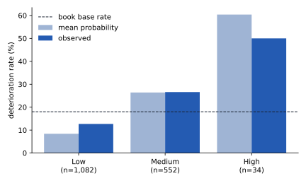

Every figure on this page names the population it was measured on. Unless stated otherwise,
that is the held-out  of the booked book: 
accounts the model never saw while it was fitted,  of them
deteriorating ([7.2](data.qmd#ews-split)). Three things are measured, and they are not the
same: the **model's ranking** (capture, PR-AUC, AUC), the **tiers** cut from it, and the
**triggers** beside it.

## The headline {#ews-headline}



**Top-decile capture** is the measure the review workflow uses. Rank the held-out accounts by
the model's probability, take the riskiest tenth —  accounts — and count
the deteriorations among them:  of the
, so capture is . A random tenth would
hold a tenth of them; the ratio is the lift, ×. Put another way, a
relationship manager working the top decile finds a deterioration in
 of the accounts called, against 
for an account picked at random.

**PR-AUC** (average precision) summarises precision across every cut of the ranking, not just
the top tenth. A ranking with no information scores about the base rate, so the gate asks for
more than that: ,  times the base rate
of .

**AUC** is reported, not gated. At  it would fail any gate set for an
origination model on this platform; why that is the data and not the model, and why the gate
is on capture instead, is the next section and [7.9](gate.qmd).

### How firm each result is

The intervals come from  bootstrap resamples of the held-out accounts,
drawn with the platform seed, as for D4 and D5 (`wiki/facts/ews_facts.py`):

- **Capture: met, narrowly.** The gate needs  of the
   deteriorations in the top decile; the model has
  , a margin of 
  accounts ( percentage points). The interval,
   to , straddles the
   gate, and  of the
  resamples fall below it. Another held-out sample of the same size, from the same book, could
  well have failed (finding 3, [7.7](limitations.qmd)).
- **PR-AUC: met, firmly.** The interval,  to
  , lies wholly above the base rate;
   of resamples fall at or below it. But the gate
  asks only for a ranking better than none ([7.7](limitations.qmd#ews-observations)).
- **AUC: above its sanity floor.** The interval,  to
  , lies wholly above the  floor.

## The ceiling {#ews-ceiling}

Because the data are generated, the best ranking any model could achieve is known: rank the
accounts by the generator's own deterioration logit without its noise term
(`wiki/facts/ceiling.py`, the only code in this documentation that reads the generator's
truth; it grades the data, not a model). A second reference point is a model, not the truth:
a reference LightGBM, configured as the committed one, given **every observable column** —
 columns: the portfolio's columns outside the
deny-list and the aggregated panel features — fitted on the same training accounts, as the workshop's
`oracle_ceiling.py` does.



**Compare only within a row's sample.** The first row is measured over all
 booked accounts, the rest over the held-out accounts. The figure quoted
in `train.py`'s gate note and in `ews/docs/enhancement_notes.md` as the "oracle ceiling" is
the first row. Setting it beside the model's held-out  makes the model look
close to the maximum; they are two different samples. On the held-out accounts themselves the
noise-free logit reaches , and the model falls short of
it by : it gets  of
the way from a coin toss to the ceiling.

**The model is indistinguishable from the reference model.** The reference LightGBM, with
every observable column, reaches  on the same
accounts: the committed model is a hair below it, well inside the AUC interval above. That is
one learner with one configuration, fitted once; it shows that more columns of the same data
did not help a model like this one, not that no better model exists. Much of the remaining
distance to the noise-free logit plausibly lies in information no observable column holds:
the generator's strongest driver of deterioration is the true PD ([7.2](data.qmd#ews-label)),
and the bank sees only the scorecard's estimate of it. That attribution is a reading of the
generator's code, not a decomposition.

### Why this is the reason the gate is on capture

An AUC gate set where the origination models are gated, 
([D4.9](../score/gate.qmd)), would be unreachable here: not by this model only, but by any
model, even one ranking by the generator's noise-free logit, which reaches
 on these accounts. A gate no honest model can pass invites
one of two failures: a model that is never accepted, or a gate quietly lowered until one is.
Early Warning was instead gated, from its first commit, on what its use needs: does the riskiest
decile, the accounts a review team can actually call, hold well more than its share of the
trouble? Even the noise-free logit captures only 
in its top decile on these accounts (PR-AUC ), so a
capture gate at the  level is reachable where the design brief's
was not. The level itself was not derived from the ceiling, and it sits close to what the
committed model achieved — which is why the narrow margin is a finding (finding 3,
[7.9](gate.qmd#history)). AUC stays on the page, reported against the ceiling, so no reader has to take its absence on
trust. That is the honest-gate design ([7.9](gate.qmd)), and it is not a limitation of the
model; how narrowly the committed model clears the gate is (finding 3).

## Benchmark: the score alone {#ews-benchmark}

The simplest early warning a bank could run is to re-rank its book by the origination score.
On the same held-out accounts:

| Ranking | AUC, held-out accounts | Top-decile capture, held-out accounts |
|---|---|---|
| Committed EWS model |  |  |
| Scorecard PD alone (`pd_score`) |  |  |

The model leads on AUC by . Because both rankings are scored on
the same accounts, the comparison is a paired bootstrap:  resamples,
each scoring both on the same resampled rows. The 95% interval for the model's lead is
 to : **it contains zero.**
On AUC the model is not distinguishable from the score it consumes — no measurable gain, and
no measurable loss. On capture, `pd_score` alone falls below the gate where the model clears
it; that is one measurement each, with no paired interval for the difference, and the model's
own capture interval straddles the gate. This chapter does not claim that Early Warning ranks
better than the score alone: finding 4 ([7.7](limitations.qmd)).

## Held out against the whole book {#ews-held-out-vs-whole-book}

The portal scores the whole booked book, and so does every chart drawn from it. Over the whole
book the same model looks far stronger:



**Only the first row is a performance measure.** The whole book is mostly the model's training
rows —  of  — and on those the model is almost
perfect (training AUC , [7.3](methodology.qmd#the-model-lightgbm)).
The whole-book capture of  is mostly the model recognising
accounts it has already seen; it says nothing about the next account it will score. The
held-out  does. This is the trap Session 3 taught by setting these two
capture figures side by side, and the numbers on its slide are these facts. The portal's own summary endpoint quotes the
held-out metrics recorded at training, which is right; but the tier counts and the watchlist
it serves are computed over the whole book, and they inherit the problem
(below, and findings 1 and 2).

The session video teaches the same point. The tier counts it shows are the whole book's,
 High of  —  by
construction — not what a new account should expect (below).



## Tiers on the held-out accounts {#ews-tiers-held-out}



{#fig-tier-calibration}

**The tiers rank.** The observed deterioration rate falls from
 in High to  in
Medium to  in Low: lifts over the base rate of
×, × and
×.

**The tiers do not hold their mix.** Built to hold  of the
book, the High tier holds  of the held-out accounts —
 accounts — and catches  of
their deteriorations. Medium swells to . A new account,
scored out-of-sample like these, will rarely be High: finding 1 ([7.7](limitations.qmd)).

**Calibration by tier.** For each tier, observed rate over mean probability, against the
tolerance the monitoring plan applies,  to
, counted only on at least
 events — here deteriorations — the same floor rule as
D4 and D5 ([7.8](monitoring.qmd)):

- High:  on 
  deteriorations, ;
- Medium:  on ,
  ;
- Low: observed  against a mean probability of
  , a ratio of  on
   deteriorations — outside the tolerance and above the
  floor, so a finding (finding 5).

The Low tier is where most accounts sit and where the probability is read least carefully;
it holds  of the held-out deteriorations.

## Triggers {#ews-trigger-performance}



Book counts and shares are over all  booked accounts: the triggers are
rules, not fitted, so the whole book is a fair population for how often they fire. Precision
— the deterioration rate among flagged accounts — and recall — the share of deteriorations
flagged — are on the held-out accounts, to sit beside the model's figures. **Lift is
precision over the book's base rate** (), not over the rate among
unflagged accounts.

What the table shows:

- **No trigger is dead, but one clause is.** Every trigger fires on some accounts. The
  `DELINQUENCY` rule's configured clause, `dpd_max` at or above
  , fires on
   accounts by itself: `dpd_max` never
  exceeds . The trigger is, in
  effect, `dpd_recent` above 
  (finding 6).
- **The triggers discriminate only modestly.** Their precision runs from
   (`DELINQUENCY`) to
   (`HIGH_UTILIZATION`), against a base rate
  of : lifts of × to
  ×, against the High tier's
  ×.
- **Together they fire on most of the book.**  of accounts
  () carry at least one trigger, and
   carry two or more. On the held-out accounts, a flagged
  account deteriorates at  against
   for an unflagged one; the flags reach
   of deteriorations by flagging most accounts (finding 7).

## Tiers and triggers together {#ews-tiers-and-triggers}

Over the book, as the portal shows them side by side:

| | Accounts | Share |
|---|---|---|
| High tier with at least one trigger |  |  of the High tier |
| High tier with no trigger |  | the rest of the High tier |
| At least one trigger, not High |  |  of triggered accounts |
| … of which Low |  | |

Most High-tier accounts come with a reason a reviewer can raise; some come with only the SHAP
reasons. Among the held-out accounts, the count of High-tier accounts with no trigger is
. The two layers are independent by design ([7.3](methodology.qmd)); the High tier
without a trigger is recorded as an observation ([7.7](limitations.qmd#ews-observations)).

## The watchlist {#ews-watchlist}

`watchlist` returns the top  accounts of the scored
book by probability: the module's default watchlist. The portal serves the top
 of the same ranking by default (`/api/ews/watchlist`), and the
v1 page shows . Over the book as the portal scores it:

| | Value | Population |
|---|---|---|
| Accounts on the list |  | the watchlist |
| … in the High tier |  | the watchlist |
| … with no trigger |  | the watchlist |
| … that are the model's training rows |  | the watchlist |
| … that are held-out accounts |  | the watchlist |
| Deterioration rate on the list |  ( accounts) | the watchlist: **in-sample, not a performance measure** |
| Deterioration rate, held-out members only |  ( of ) | far too few to measure anything |
| Top , the portal's default: training rows, deterioration rate | ;  | the portal's watchlist: **in-sample** |
| Top , the v1 page: training rows, deterioration rate | ;  | the v1 page's watchlist: **in-sample** |

The module's watchlist is almost entirely accounts the model was fitted on, and what the portal
and the v1 page show is entirely so; their near-perfect hit rates are the model remembering
those accounts' labels. It is the most visible in-sample number on the
platform and the easiest to misread: finding 2 ([7.7](limitations.qmd)). The honest guide to
what a call list of the riskiest accounts will find is the held-out top decile's rate,
.

## Stability

No population stability index is computed for the model's features. The training and
held-out accounts are a random partition of one book, so a PSI between them would measure
sampling noise, not drift; and there is no second period to compare (D4 finding 1,
[7.4](assumptions.qmd#ews-the-label-looks-forward)). The one PSI recorded is the tier mix,
held out against the book —  — which measures the in-sample
problem of finding 1, not drift. The monitoring plan carries stability over time
([7.8](monitoring.qmd)).
