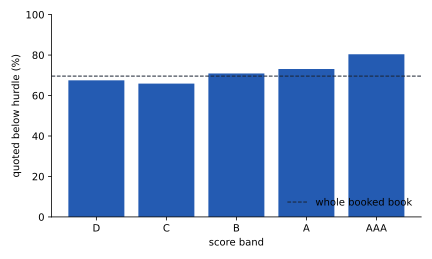

A tool has no discrimination or calibration to measure. This page asks the two questions
that replace them ([D6](index.qmd#how-the-template-is-adapted-for-a-tool)): **is the
arithmetic right, everywhere it runs?** and **what does it report about the book?** Every
figure names its population; unless stated otherwise it is the booked book,
 loans, priced with the scorecard's PD ([6.2](data.qmd)).

## The arithmetic holds on every loan {#pr-identities}

The unit tests check each identity of [6.3](methodology.qmd#pr-identity) on one made-up
loan. The facts behind this chapter check the same identities on every booked loan, through
the engine's own functions, and fail the build if any residual reaches the unit tests'
tolerance,  (`wiki/facts/pricing_facts.py`):

| Identity, over all  booked loans | Largest residual |
|---|---|
| ROE at the break-even rate is zero |  |
| ROE at the hurdle-clearing rate is the hurdle |  |
| Recommended rate = hurdle-clearing rate + base margin |  |
| The waterfall adds up; ROE = net income / equity |  |
| ROE does not depend on EAD |  |
| The first two again, with `fee_rate` at  |  |
| The largest of the first five |  |

The residuals are of the order of a double's rounding error. Their last digits depend on the
platform's floating-point library, so each is printed as the bound it is asserted against,
not as a value: a printed value would differ by machine and fail `verify.py` there for no
reason. The last-but-one row exists because no unit test sets a fee; it is the interim
control for finding 4 ([6.7](limitations.qmd)).

## The what-if equals the batch {#pr-whatif}

The portal prices a loan two ways: the v1 views read the batch (`price_population`, run once
at start-up), and the v2 workbench prices the loan on request with `price_one`, which its
what-if then re-runs with the reviewer's values ([6.1](purpose.qmd#who-consumes-it-and-how)).
With no overrides the two must agree. Over every booked loan:

| Check, over all  booked loans | Result |
|---|---|
| Loans whose clear-or-miss verdict differs |  |
| Largest difference in ROE, recommended rate or quoted rate |  |
| Largest difference in the PD the two paths use |  |

The two agree on every verdict, and to within the engine tests' tolerance on every number —
but not to the last bit, and the reason is worth knowing. The workbench takes its PD from
`predict_score_pd` run once over all  applicants at start-up;
`price_population` runs it over the  booked rows alone. The same
scorecard, given a different batch of rows, returns PDs that can differ in the last binary
digit, and the engine carries that difference through. It is a property of the scorecard's
batch prediction, not of pricing, and it is bounded above. Recorded as an observation
([6.7](limitations.qmd#pr-observations)).

The test suite checks the same agreement through the HTTP endpoints, with the body the
browser actually sends ([6.9](gate.qmd)). The book-level what-if (`_book_under`) re-prices
from the batch's own PDs, so it reproduces the batch's counts exactly.

## What the tool reports about the book {#pr-headline}



At the rate each loan was quoted,  of the
 booked loans () clear the
 hurdle. The median loan earns an ROE of
. The median quoted rate is ;
the median recommended rate is . Among the
 mispriced loans, the median shortfall is
 basis points of rate.

Two groups sit inside the mispriced count, and the summary does not separate them:

- loans that earn a profit but less than the hurdle; and
- ** loans ()
  quoted below their break-even rate**, with \$ of
  EAD. These lose money at their own quote: their ROE is negative. The facts assert that the
  two sets are the same loans ( with negative ROE).

`portfolio_summary` reports the loans priced, the loans clearing and their share, the median
ROE and the mispriced EAD. The below-break-even row, the medians of the two rates and the
total EAD come from the facts, computed through the engine, not from the tool's summary
(finding 2, [6.7](limitations.qmd)).

**How to read the level.** These figures measure the quotes in the committed data. Those
quotes were generated, not set by a pricing desk: the generator prices each loan to
break-even at the generator's own true PD plus the base margin, with no capital charge
([6.4](assumptions.qmd#pr-capital-charge)). A quote built that way misses the hurdle unless
something lifts it by the  the capital charge
exceeds the margin by. The level of the mispriced share is set by that construction, not by
anything the engine estimates: finding 1 ([6.7](limitations.qmd)). The measure itself is
sound; this page shows it working.



## Where mispricing concentrates

### By score band {#pr-by-band}



{#fig-mispriced-by-band}

Two readings of the same table, and they point at different bands:

- **By share, the best bands.** The mispriced share is highest in band
   (), then
   (), and lowest in band
   (). In the best bands PD × LGD
  is small, so a difference between the scorecard's PD and the PD the quote was built on is
  typically small in rate terms too. The quote then sits close to the hurdle-clearing rate less
  the  gap, and a loan clears only if the quote's
  random term (`rng.normal(0.0, 0.003, n)` in the generator) happens to cover it. In band D,
  where PD × LGD is large, a difference between the two PDs moves the quote against the
  hurdle-clearing rate by more, in both directions, and more loans land on the clearing side.
- **By money, band D.** Band D holds \$ of
  mispriced EAD, the most of any band, and the lowest median ROE,
  . Its share mispriced,
  , is below the book's; its exposure is the largest.

The best bands are also where the scorecard's PD is least supported on the booked: D4
finds band B under-predicting default there (D4 finding 6), and bands A and AAA outside the
tolerance on too few defaults to count. A PD that is too low makes the hurdle-clearing rate too
low, so in those bands the measured shortfall would, if anything, understate the true one;
it does not explain why the share is highest there. Finding 3 ([6.7](limitations.qmd))
records both.

### By industry



The mispriced share runs from  in
 to  in
. Industry has no role in how the generator draws default,
or in how it sets the quote: it is a structural zero ([glossary](../../reference/glossary.qmd)),
and the spread is sampling noise. It is the same teaching case as in D4, where industry's
tidy spread of default rates is an honest chart with no story behind it. No industry-level
action follows from this table.
